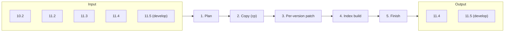

<div align="center">

# cubrid-fastmig

**Offline migration of a CUBRID database to a newer release, without unloaddb/loaddb**

[한국어](README.md) | **English**


</div>

---

cubrid-fastmig moves a cleanly shut down CUBRID 10.2 or 11.2–11.5 database directly to the 11.4 or 11.5 (develop)
on-disk format. It does not export the data as SQL and load it again: it clones the volumes (reflink), fixes on disk
only what the format changed, and rebuilds every index in parallel. It is written in Rust and does not link or run
any CUBRID engine binary.

| 22 million rows, 49 indexes (about 4.3 GB), 11.4 → 11.5 | Wall time |
|---|---|
| Official path: 11.4 `unloaddb` → 11.5 `loaddb` (CS mode, 16-way parallel) | 148.9 s |
| **cubrid-fastmig** (clone) | **17.4 s** |

Conditions and per-stage times: [docs/measurements.md](docs/measurements.md)

## Contents

- [How it works](#how-it-works)
- [Supported versions](#supported-versions)
- [Quick start](#quick-start)
- [Commands and options](#commands-and-options)
- [Required SQL after the migration](#required-sql-after-the-migration)
- [Safety](#safety)
- [Verification](#verification)
- [Not in scope](#not-in-scope)
- [Layout](#layout)
- [Build](#build)
- [Documents](#documents)
- [License](#license)

## How it works



1. **Plan** (`plan`): reads the source version from its log header and fixes the version pair. It
   picks, per volume, clone or copy, and per class, whether its pages stay as they are, are patched, or are
   transformed. Before anything is written it shows the least and the most temp disk the index build needs. Every
   decision is made here once; later stages only read it.
2. **Copy (cp)**: a volume whose target directory is on the source's filesystem is cloned with reflink; any other is
   byte-copied in parallel.
3. **Per-version patch**: user heap and overflow pages keep their placement (volid/pageid/slot), so class OIDs and OBJECT
   references survive unchanged. Only the fields whose format changed are rewritten; the system catalog is
   regenerated in the target format.
4. **Index build**: every index is rebuilt, even on a same-version run
   ([ADR 0005](docs/adr/0005-rebuild-every-index.md)). Key sorting, run merging and leaf shards run in parallel
   within `--thread-count` and `--temp-mem-size`.
5. **Finish** (new log and fsync): the target starts a new log after the end of the source's log. Every write is made durable
   in one fsync pass at the end. With `--check` the target is verified against the source and registered only when no
   migration defect is found.

## Supported versions

| Source ＼ Target | 11.4 | 11.5 (develop) |
|---|:---:|:---:|
| 10.2 | ✅ | ✅ |
| 11.0 | — | — |
| 11.2 | ✅ | ✅ |
| 11.3 | ✅ | ✅ |
| 11.4 | ✅ (same version) | ✅ |
| 11.5 (develop) | refused (downgrade) | ✅ (same version) |

- The target line is read from `lib/libcubrid.so` of the install `$CUBRID`; `--target-version 11.4|develop` overrides it.
- An 11.0 source is out of scope. 9.3 sources are excluded: no release sources or binaries are available.
- No downgrades and no multi-hop migrations through intermediate versions
  ([ADR 0003](docs/adr/0003-offline-direct-upgrade-only.md)).

## Quick start

```sh
# 0. Build (Rust toolchain pinned through nix)
just toolchain && just release
alias cubrid-fastmig=$PWD/target/release/cubrid-fastmig

# 1. Shut the source down cleanly and point CUBRID at the target install
cubrid server stop demodb
export CUBRID=/opt/cubrid-11.4        # target install

# 2. Look at the plan (writes nothing; exit 1 when it refuses)
cubrid-fastmig plan demodb -F /data/demodb-new

# 3. Migrate and verify (registered in databases.txt only with 0 migration defects)
cubrid-fastmig migrate demodb -F /data/demodb-new --check -t 16 --temp-mem-size 16G

# 4. Run the SQL files it printed, in order, as DBA
csql -u dba demodb -i /data/demodb-new/fastmig/recompile-plcsql.sql
# ... (see "Required SQL after the migration")
#    or add --engine-check to step 3: the tool runs them with $CUBRID's csql in SA mode and checks with the engine

# 5. Delete the source (allowed only after a passing check, with the source unchanged)
cubrid-fastmig finalize /data/demodb-new
```

## Commands and options

The options follow the CUBRID utilities (copydb, createdb) and take `--flag value`, `--flag=value` and the short
forms (`-F dir`, `-Fdir`); `-h` prints a command's whole help. Defaults come from the target install and its
`cubrid.conf`, and the command line always wins.

```sh
cubrid-fastmig plan     <db> [<new-db>] -F <dir> [options]   # reads only; exit 1 when it refuses
cubrid-fastmig migrate  <db> [<new-db>] -F <dir> [-L <log dir>] [-B <lob dir>] [-E <dir> | -i <control file>]
                        [-r] [-d | --check] [-t <threads>] [--temp-mem-size <size>] [--temp-disk-size min|max|<size>]
                        [--run-sql | --engine-check [--engine-checkdb] [--source-cubrid <install>]]
cubrid-fastmig check    <db | first-volume-path> [--source <db | path>] [-t <threads>]
cubrid-fastmig set-comparison <source-unload-prefix> <target-unload-prefix>
cubrid-fastmig post     <target-dir> [--engine-check [--engine-checkdb] [--source-cubrid <install>]]
cubrid-fastmig finalize <target-dir>
```

Exit codes: 0 success, 1 failure (`plan` refused, `check` defects, `set-comparison` differences), 2 usage error, 3 the
migration finished but the SQL of `--run-sql` or the engine check failed (the target stays registered).

| Option | Default |
|---|---|
| `--target-version 11.4\|develop` | the line of the install `$CUBRID` (`lib/libcubrid.so` → `libcubrid.so.<major>.<minor>`); an error when it cannot be read |
| `-t, --thread-count` | CPUs / 2 |
| `--temp-mem-size` | target conf `data_buffer_size`; else asked on a terminal, physical memory / 4 (at least 256M) otherwise |
| `--temp-disk-size` | target conf `temp_file_max_size_in_pages`: > 0 → pages × page size, 0 → min; else asked on a terminal, max otherwise |
| `--db-volume-size` | target conf `db_volume_size`, else 512M |
| `--server-name` | the source's db-host |
| `--no-clone` | (off) byte-copy every volume, for a target that must not share blocks with the source |
| `--run-sql` | (off) once registered, run the required SQL with `$CUBRID`'s `csql` in SA mode |
| `--engine-check` | (off) turns on `--run-sql`, then checks each class's row count and a query through each index with the engine |
| `--engine-checkdb` | (off) adds `cubrid checkdb -S` to the engine check |
| `--source-cubrid <install>` | (none) adds a whole-data comparison to the engine check: the source line's install unloads a copy of the source |

A name the tool had before (`--dest`, `--log-dir`, `--lob-dir`, `--workers`, `--mem`, `--temp-disk`, `--verify`,
`--target-name`, the command `verify`) is refused with the name that replaced it.

### Set disk and memory use before the run

`plan` shows the temp disk the index rebuild needs at least (one index at a time) and at most (every index at once),
and what the batches in between cost in time. On a terminal `migrate` first shows the absolute source and target
paths (volumes, logs, LOB, Java SP, databases.txt), then asks in a box screen the temp disk and temp mem no option or
conf set (Enter: recommended). `migrate --temp-disk-size min|max|<size>` picks one before anything is
written and keeps to it by building the indexes in batches. The index build and the verifier keep their keys, sort
and merge buffers inside `--temp-mem-size`, merging spilled runs in more passes when few fit. How the bounds are
computed: [docs/resources.md](docs/resources.md)

## Required SQL after the migration

`migrate` ends by printing the files below with what each fixes (on a terminal, in the `ACTION REQUIRED` box at the
bottom, as `csql` commands to copy and run), and keeps the same list in `<dest>/fastmig/report.json` (`required_sql`). Run them as DBA, in this order, before the target is used
(`csql -u dba <db> -i <dest>/fastmig/<file>`); a file with nothing to do is not listed.

1. `recompile-plcsql.sql`: recompiles PL/CSQL routines, which run their copied compiled code until then.
2. `recompile-views.sql` (a source older than the target): `ALTER VCLASS … CHANGE QUERY` per view spec, so the target
   stores the column casts loaddb would. Until it runs, a view column can return another domain than declared.
3. `deferred-indexes.sql`: builds the function and filter indexes migrate did not build
   ([ADR 0006](docs/adr/0006-defer-function-and-filter-indexes.md)).
4. `update-statistics.sql`: `UPDATE STATISTICS ON ALL CLASSES;`

`post-migration-fixes.sql` is not on that list: review its statements one by one before they run.

### Let the tool run them and check with the engine

With a CUBRID install of the target line (`$CUBRID`), `migrate --run-sql` runs the files above in this order with
`csql -S -u dba -i` once the target is registered. These options and the `post` command are the only places the tool
starts the engine; the migration itself runs without it ([ADR 0018](docs/adr/0018-engine-runs-only-after-migration-in-sa-mode.md)).
csql exits 0 after a failed statement, so an `ERROR` on its stderr decides; the run stops at the failed file and
reports the file, the line and its `.err` file. `--engine-check` then checks with the engine:

- per class, the engine's `COUNT(*) FROM ONLY` equals the rows the tool counted on the target's volumes (a
  partitioned class with its partitions);
- per index, `key >= <its minimum> … USING INDEX` plans an index scan of that index and counts what the heap counts
  under `USING INDEX NONE`. The heap is read once per class: one query counts the class's rows and the rows of each of
  its indexes, run REPEATABLE READ (under READ COMMITTED the engine answers a `COUNT(*)` without WHERE from the B-tree
  statistics the tool wrote, without reading the heap). A key the engine does not range-scan (no index scan after a retry with `=`, e.g. a `utf8_en_ci` column) is
  not counted as passed: it is listed as `skipped` with the reason.
- `--engine-checkdb`: `cubrid checkdb -S`. `--source-cubrid <install>`: the source line's install runs `unloaddb -S` on
  a copy of the source (reflink on the same filesystem, else a byte copy, refused before writing when it does not
  fit), the target install unloads the target, and `set-comparison` compares them. `unloaddb` writes to the database
  it reads, so the source itself is never opened. 10.2, 11.0 and 11.2 installs need `libncurses.so.5` on
  `LD_LIBRARY_PATH`.

The outcome is the `post` item of `report.json` and the end of `migrate.log`; the engine output is in
`<dest>/fastmig/post/`. A failure exits 3 and leaves the target registered; `finalize` refuses a target whose engine
check failed. On a target migrated earlier, `cubrid-fastmig post <target-dir> [--engine-check]` does the same later
and does not rerun a file an earlier `post` ran without error.

## Safety

- **The source is deleted only after verification.** `finalize <target-dir>` deletes the source only when a check
  passed (`migrate --check` or a later `check`) and the source is unchanged since the migration
  ([ADR 0008](docs/adr/0008-source-deleted-only-by-finalize.md)). `migrate -d` deletes it only when its own check
  found 0 migration defects. When `--run-sql` or the engine check fails, `migrate -d` deletes nothing, and `finalize`
  refuses a target whose engine check failed.
- **An unfinished run is marked.** The target holds `FASTMIG_INCOMPLETE` until it is registered, and a second
  migrate into a directory another one holds is refused.
- **Pre-existing defects are told apart.** The verifier checks both source and target, so a defect already in the
  source is not reported as a migration defect.

## Verification

- **Structure** (`check`, [docs/verify.md](docs/verify.md)): heap, index, catalog, sector ownership and LOB files in
  O(n log n). With `--source` each target defect is sorted into a migration defect, a pre-existing defect or a
  resolved defect.
- **Data** (`set-comparison`): compares the `unloaddb` output of source and target as sets of rows.
- **Operations scenario and version matrix** ([docs/ops-verification.md](docs/ops-verification.md)): each version
  pair is migrated by cubrid-fastmig and by the official path (unloaddb → loaddb), the same operations scenario runs
  on both, and their outputs must be equal: DML, UPDATE STATISTICS, checkpoint, recovery after `kill -9`, vacuumdb,
  addvoldb, compactdb, backupdb, restoredb. All 19 rows pass.
- **Ported testcases** ([tc/README.md](tc/README.md)): CUBRID shell testcases run through the migration (`just tc`).

## Not in scope

- Downgrades and multi-hop migrations through intermediate versions.
- Online or incremental migration; the source must be shut down cleanly.
- The log and backup chains of the source; the target starts with a new log, so take a full backup after the migration.
- Moving an HA pair as one. Each node is migrated on its own and the pair is configured again on the target line
  ([docs/ops-verification.md](docs/ops-verification.md) § HA).
- Sources with TDE-encrypted tables.
- Changes to the CUBRID engine.

## Layout

| Crate | Role |
|---|---|
| `crates/ondisk` | On-disk structures: volume and page headers, heap records, file headers, log header |
| `crates/plan` | The migration plan: version pair, copy method per volume, page treatment grade per class, deferred indexes, LOB manifest, pre-check |
| `crates/progress` | Phases of a run, their per-worker counters, ETA, and the progress display (screen or lines) |
| `crates/copy` | Parallel copy, patch and transform passes |
| `crates/catalog` | Catalog regeneration in the target format |
| `crates/index` | Parallel index rebuild |
| `crates/verify` | Heap, index and catalog verifier |
| `crates/cli` | The `cubrid-fastmig` command |
| `tc/` | Ported testcases ([tc/README.md](tc/README.md)) |
| `e2e/` | End-to-end runs on real databases and the operations scenario ([e2e/README.md](e2e/README.md)) |
| `basedb/` | Scripts that build the baseline database per version ([basedb/README.md](basedb/README.md)) |

## Build

The repository is driven by [just](https://just.systems). The Rust toolchain is pinned through nix
(`toolchain.nix`); every recipe runs cargo from `.toolchain/bin`, not the host's.

```sh
just toolchain          # build or refresh the pinned toolchain (.toolchain GC root)
just build              # debug build; `just release` for an optimized one
just check              # rustfmt --check and clippy -D warnings
just fmt                # format in place
just run --help         # run cubrid-fastmig with its arguments
```

`just` alone lists the recipes. The rules for writing code here are in [AGENTS.md](AGENTS.md).

## Documents

| Document | Content |
|---|---|
| [GLOSSARY.md](GLOSSARY.md) | Vocabulary |
| [docs/adr/](docs/adr/) | Hard-to-reverse design decisions (ADR 0001–0018) |
| [docs/resources.md](docs/resources.md) | Disk and memory bounds, progress display and ETA |
| [docs/verify.md](docs/verify.md) | The verifier's checks and defect codes |
| [docs/ops-verification.md](docs/ops-verification.md) | Operations scenario, version matrix, HA |
| [docs/intended-differences.md](docs/intended-differences.md) | Intended differences from the official path |
| [docs/measurements.md](docs/measurements.md) | Speed measurements |

## License

Apache-2.0. See [LICENSE](LICENSE).
