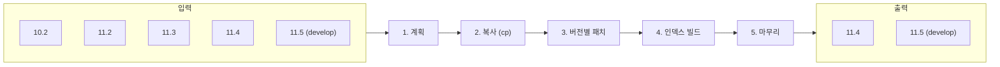

<div align="center">

# cubrid-fastmig

**unloaddb/loaddb 없이 CUBRID 데이터베이스를 새 버전으로 옮기는 오프라인 마이그레이션 도구**

**한국어** | [English](README.en.md)


</div>

---

cubrid-fastmig는 정상 종료된 CUBRID 10.2, 11.2–11.5 데이터베이스를 11.4 또는 11.5(develop) 형식으로 바로 옮깁니다.
데이터를 SQL로 꺼냈다가 다시 넣지 않습니다. 볼륨을 복사(reflink clone)한 뒤 바뀐 부분만 디스크 위에서 고치고,
인덱스를 병렬로 다시 만듭니다. Rust로 작성했고 CUBRID 엔진 바이너리를 링크하거나 실행하지 않습니다.

| 2,200만 행, 인덱스 49개 (약 4.3 GB), 11.4 → 11.5 | 걸린 시간 |
|---|---|
| 공식 경로: 11.4 `unloaddb` → 11.5 `loaddb` (CS 모드, 16 병렬) | 148.9 s |
| **cubrid-fastmig** (clone) | **17.4 s** |

측정 조건과 단계별 시간: [docs/measurements.md](docs/measurements.md)

## 목차

- [동작 방식](#동작-방식)
- [지원 버전](#지원-버전)
- [빠른 시작](#빠른-시작)
- [명령과 옵션](#명령과-옵션)
- [마이그레이션 뒤 반드시 실행할 SQL](#마이그레이션-뒤-반드시-실행할-sql)
- [안전 장치](#안전-장치)
- [검증](#검증)
- [범위 밖](#범위-밖)
- [저장소 구성](#저장소-구성)
- [빌드](#빌드)
- [문서](#문서)
- [라이선스](#라이선스)

## 동작 방식



1. **계획** (`plan`): 원본 로그 헤더에서 버전을 읽고 버전 쌍을 정합니다. 볼륨마다 clone할지
   복사할지, 클래스마다 페이지를 그대로 둘지·고칠지(patch)·다시 쓸지(transform) 정합니다. 쓰기 전에
   인덱스 빌드에 필요한 temp 디스크의 최소·최대를 보여 줍니다. 결정은 여기서 한 번만 하고 뒤 단계는 읽기만 합니다.
2. **복사 (cp)**: 도착 디렉터리가 원본과 같은 파일 시스템이면 reflink로 clone하고, 아니면 병렬로 바이트 복사합니다.
3. **버전별 패치**: 사용자 힙과 overflow 페이지는 자리(volid/pageid/slot)를 그대로 지킵니다.
   그래서 클래스 OID와 OBJECT 참조가 바뀌지 않습니다. 형식이 바뀐 필드만 고치고, 시스템 카탈로그는 도착 버전 형식으로 다시 만듭니다.
4. **인덱스 빌드**: 같은 버전끼리 옮길 때도 모든 인덱스를 새로 만듭니다([ADR 0005](docs/adr/0005-rebuild-every-index.md)).
   키 정렬, 정렬 run 병합, leaf 샤드가 `--thread-count`와 `--temp-mem-size` 안에서 병렬로 돕니다.
5. **마무리** (새 로그와 fsync): 도착 DB는 원본 로그 끝 뒤에서 새 로그로 시작합니다. 모든 쓰기를 마지막에 한 번 fsync합니다.
   `--check`를 주면 도착 DB를 원본과 비교 검증하고, 결함이 없을 때만 등록합니다.

## 지원 버전

| 원본 ＼ 도착 | 11.4 | 11.5 (develop) |
|---|:---:|:---:|
| 10.2 | ✅ | ✅ |
| 11.0 | — | — |
| 11.2 | ✅ | ✅ |
| 11.3 | ✅ | ✅ |
| 11.4 | ✅ (같은 버전) | ✅ |
| 11.5 (develop) | 다운그레이드 거부 | ✅ (같은 버전) |

- 도착 버전은 `$CUBRID` install의 `lib/libcubrid.so`에서 읽습니다. `--target-version 11.4|develop`으로 바꿀 수 있습니다.
- 11.0 원본은 범위 밖입니다. 9.3 원본은 릴리스 소스·바이너리가 없어 제외했습니다.
- 다운그레이드, 중간 버전을 거치는 다단계 이관은 하지 않습니다([ADR 0003](docs/adr/0003-offline-direct-upgrade-only.md)).

## 빠른 시작

```sh
# 0. 빌드 (nix로 고정한 Rust 툴체인)
just toolchain && just release
alias cubrid-fastmig=$PWD/target/release/cubrid-fastmig

# 1. 원본 서버를 정상 종료하고, 도착 버전 CUBRID 환경을 잡는다
cubrid server stop demodb
export CUBRID=/opt/cubrid-11.4        # 도착 install

# 2. 계획만 본다 (아무것도 쓰지 않는다. 거부하면 exit 1)
cubrid-fastmig plan demodb -F /data/demodb-new

# 3. 옮기고 검증한다 (결함이 0일 때만 databases.txt에 등록)
cubrid-fastmig migrate demodb -F /data/demodb-new --check -t 16 --temp-mem-size 16G

# 4. 끝에 출력된 SQL을 순서대로 DBA로 실행한다
csql -u dba demodb -i /data/demodb-new/fastmig/recompile-plcsql.sql
# ... (아래 "마이그레이션 뒤 반드시 실행할 SQL")
#    또는 3에 --engine-check를 붙여 도구가 $CUBRID의 csql로 SA 모드에서 대신 실행하고 엔진으로 확인하게 한다

# 5. 원본 삭제 (검증 통과 + 원본이 그대로일 때만 허락)
cubrid-fastmig finalize /data/demodb-new
```

## 명령과 옵션

옵션은 CUBRID 유틸리티(copydb, createdb)를 따릅니다. `--flag value`, `--flag=value`, 짧은 형식(`-F dir`, `-Fdir`)을
모두 받고, `-h`는 그 명령의 전체 도움말을 보여 줍니다. 기본값은 도착 install과 그 `cubrid.conf`에서 오며, 명령줄이 항상 이깁니다.

```sh
cubrid-fastmig plan     <db> [<new-db>] -F <dir> [options]   # 읽기만 함, 거부하면 exit 1
cubrid-fastmig migrate  <db> [<new-db>] -F <dir> [-L <log dir>] [-B <lob dir>] [-E <dir> | -i <control file>]
                        [-r] [-d | --check] [-t <threads>] [--temp-mem-size <size>] [--temp-disk-size min|max|<size>]
                        [--run-sql | --engine-check [--engine-checkdb] [--source-cubrid <install>]]
cubrid-fastmig check    <db | first-volume-path> [--source <db | path>] [-t <threads>]
cubrid-fastmig set-comparison <source-unload-prefix> <target-unload-prefix>
cubrid-fastmig post     <target-dir> [--engine-check [--engine-checkdb] [--source-cubrid <install>]]
cubrid-fastmig finalize <target-dir>
```

종료 코드: 0 성공, 1 실패(`plan` 거부, `check` 결함, `set-comparison` 차이), 2 사용법 오류, 3 마이그레이션은 끝났지만
`--run-sql`의 SQL이나 엔진 확인이 실패(도착은 등록된 채로 남음).

| 옵션 | 기본값 |
|---|---|
| `--target-version 11.4\|develop` | `$CUBRID` install의 버전(`lib/libcubrid.so` → `libcubrid.so.<major>.<minor>`), 읽을 수 없으면 오류 |
| `-t, --thread-count` | CPU 수 / 2 |
| `--temp-mem-size` | 도착 conf `data_buffer_size`, 없으면 물리 메모리 / 4 (최소 256M) |
| `--temp-disk-size` | 도착 conf `temp_file_max_size_in_pages`: > 0 → 페이지 수 × 페이지 크기, 0 → min. 없으면 터미널에서 묻고, 아니면 max |
| `--db-volume-size` | 도착 conf `db_volume_size`, 없으면 512M |
| `--server-name` | 원본의 db-host |
| `--no-clone` | (끔) 도착이 원본과 블록을 공유하면 안 될 때 모든 볼륨을 바이트 복사 |
| `--run-sql` | (끔) 등록 뒤 필수 SQL을 `$CUBRID`의 `csql`로 SA 모드에서 실행 |
| `--engine-check` | (끔) `--run-sql`을 켜고, 엔진으로 클래스별 행 수와 인덱스별 조회를 확인 |
| `--engine-checkdb` | (끔) 엔진 확인에 `cubrid checkdb -S`를 더함 |
| `--source-cubrid <install>` | (없음) 엔진 확인에 전체 데이터 비교를 더함: 원본 버전 install이 원본 사본을 unload |

예전 이름(`--dest`, `--log-dir`, `--lob-dir`, `--workers`, `--mem`, `--temp-disk`, `--verify`, `--target-name`,
`verify` 명령)은 거부하고, 대신 쓸 이름을 알려 줍니다.

### 작업 전 디스크, 메모리 사용량 정하기

`plan`은 인덱스 재빌드에 드는 temp 디스크의 최소(인덱스 하나씩)와 최대(모든 인덱스를 한 번에)를 보여 주고,
그 사이 배치 수에 따른 시간 차이도 보여 줍니다. `migrate --temp-disk-size min|max|<size>`는 쓰기 전에 하나를 고르고,
인덱스를 배치로 나눠 빌드해서 그 한도를 지킵니다. 인덱스 빌드와 검증기는 키, 정렬, 병합 버퍼를 `--temp-mem-size`
안에서 쓰고, 넘치면 디스크로 내린 run을 여러 번 병합합니다. 계산 방법: [docs/resources.md](docs/resources.md)

## 마이그레이션 뒤 반드시 실행할 SQL

`migrate`는 마지막에 아래 파일과 각 파일이 고치는 것을 출력하고(터미널에서는 맨 아래 `ACTION REQUIRED` 박스에 바로
복사해 실행할 `csql` 명령으로), 같은 목록을 `<dest>/fastmig/report.json` (`required_sql`)에 남깁니다. 도착 DB를 쓰기 전에 DBA로 이 순서대로 실행하세요
(`csql -u dba <db> -i <dest>/fastmig/<file>`). 할 일이 없는 파일은 목록에 나오지 않습니다.

1. `recompile-plcsql.sql`: PL/CSQL 루틴을 다시 컴파일합니다. 그 전까지는 복사된 컴파일 결과로 돕니다.
2. `recompile-views.sql`: 원본이 도착보다 오래된 버전일 때 나옵니다. 뷰 spec마다 `ALTER VCLASS … CHANGE QUERY`를 실행해서
   loaddb가 저장했을 컬럼 캐스트를 도착에 저장합니다. 실행 전에는 뷰 컬럼이 선언과 다른 도메인을 돌려줄 수 있습니다.
3. `deferred-indexes.sql`: migrate가 만들지 않은 함수 인덱스와 필터 인덱스를 만듭니다([ADR 0006](docs/adr/0006-defer-function-and-filter-indexes.md)).
4. `update-statistics.sql`: `UPDATE STATISTICS ON ALL CLASSES;`

`post-migration-fixes.sql`은 이 목록에 없습니다. 문장을 하나씩 검토한 뒤 실행하세요.

### 도구가 대신 실행하고 엔진으로 확인하기

도착 버전 CUBRID install(`$CUBRID`)이 있으면 `migrate --run-sql`이 등록 뒤 위 파일을 이 순서대로 `csql -S -u dba -i`로
실행합니다. 엔진을 띄우는 것은 이 옵션들과 `post` 명령뿐이고, 마이그레이션 자체는 엔진 없이 돕니다([ADR 0018](docs/adr/0018-engine-runs-only-after-migration-in-sa-mode.md)).
csql은 문장이 실패해도 0으로 끝나므로 stderr의 `ERROR`로 판정하고, 실패한 파일에서 멈춰 파일, 줄, `.err` 경로를 보고합니다.
`--engine-check`는 이어서 엔진으로 확인합니다.

- 클래스마다 엔진의 `SELECT COUNT(*) FROM ONLY`가 도구가 도착 볼륨에서 센 행 수와 같은지(분할 클래스는 파티션 합).
- 인덱스마다 첫 키의 최솟값으로 `key >= 최솟값 … USING INDEX`를 실행해 실행 계획이 그 인덱스의 index scan이고 건수가
  `USING INDEX NONE`과 같은지. 엔진이 range scan하지 않는 키(`=`로 다시 시도한 뒤에도 index scan이 아닌 키, 예: `utf8_en_ci`
  열)는 통과로 세지 않고 `skipped`로 사유와 함께 남깁니다.
- `--engine-checkdb`: `cubrid checkdb -S`. `--source-cubrid <install>`: 원본 버전 install이 원본의 사본(같은 파일시스템이면
  reflink, 아니면 바이트 복사; 모자라면 쓰기 전에 거부)을 `unloaddb -S`하고, 도착을 `unloaddb -S`해서 `set-comparison`으로
  비교합니다. `unloaddb`는 읽기만 하는 DB에도 쓰기 때문에 원본 자체는 열지 않습니다. 10.2, 11.0, 11.2 install은
  `libncurses.so.5`가 `LD_LIBRARY_PATH`에 있어야 합니다.

결과는 `report.json`의 `post` 항목과 `migrate.log` 끝에 남고, 엔진 출력은 `<dest>/fastmig/post/`에 있습니다. 실패하면
종료 코드 3이고 도착은 등록된 채로 남습니다. 엔진 확인이 실패한 도착은 `finalize`가 거부합니다. 이미 옮긴 도착에는
`cubrid-fastmig post <target-dir> [--engine-check]`로 같은 일을 나중에 할 수 있고, 앞선 `post`가 성공한 파일은 다시 실행하지 않습니다.

## 안전 장치

- **원본은 검증한 뒤에만 지웁니다.** `finalize <target-dir>`는 검증이 통과했고(`migrate --check` 또는 이후 `check`)
  마이그레이션 뒤 원본이 바뀌지 않았을 때만 원본을 지웁니다([ADR 0008](docs/adr/0008-source-deleted-only-by-finalize.md)).
  `migrate -d`도 자기 검증에서 마이그레이션 결함이 0일 때만 지웁니다. `--run-sql`이나 엔진 확인이 실패하면 `migrate -d`는 지우지 않고, 엔진 확인이 실패한 도착이면 `finalize`가 거부합니다.
- **실패한 실행은 표시가 남습니다.** 등록 전까지 도착에는 `FASTMIG_INCOMPLETE` 표시가 있고, 다른 migrate가 같은 디렉터리를 잡고 있으면 거부합니다.
- **원본에 원래 있던 결함은 구분합니다.** 검증기는 원본과 도착을 모두 검사해서, 원본에 이미 있던 결함을 마이그레이션 결함으로 보고하지 않습니다.

## 검증

- **구조 검증** (`check`, [docs/verify.md](docs/verify.md)): 힙, 인덱스, 카탈로그, 섹터 소유, LOB 파일을 O(n log n)으로 검사합니다.
  `--source`를 주면 결함을 마이그레이션 결함 / 원래 있던 결함 / 해결된 결함으로 나눕니다.
- **데이터 비교** (`set-comparison`): 원본과 도착을 각각 `unloaddb`한 결과를 행 집합으로 비교합니다.
- **운영 시나리오와 버전 매트릭스** ([docs/ops-verification.md](docs/ops-verification.md)): 버전 쌍마다 cubrid-fastmig 결과와
  공식 경로(unloaddb → loaddb) 결과에 같은 운영 시나리오를 돌리고 두 출력이 같은지 봅니다. DML, UPDATE STATISTICS,
  checkpoint, `kill -9` 뒤 복구, vacuumdb, addvoldb, compactdb, backupdb, restoredb를 거칩니다. 지금 19개 행이 모두 통과입니다.
- **이식한 테스트케이스** ([tc/README.md](tc/README.md)): CUBRID shell 테스트케이스를 마이그레이션 지점을 거쳐 실행합니다(`just tc`).

## 범위 밖

- 다운그레이드, 중간 버전을 거치는 다단계 이관
- 온라인·증분 마이그레이션. 원본은 정상 종료되어 있어야 합니다.
- 원본의 로그와 백업 체인. 도착은 새 로그로 시작하므로 마이그레이션 뒤 전체 백업을 받으세요.
- HA 쌍을 한 번에 옮기기. 노드마다 따로 옮기고 도착 버전에서 쌍을 다시 구성합니다(절차는 [docs/ops-verification.md](docs/ops-verification.md) § HA).
- TDE로 암호화된 테이블이 있는 원본
- CUBRID 엔진 수정

## 저장소 구성

| 크레이트 | 역할 |
|---|---|
| `crates/ondisk` | 디스크 구조: 볼륨·페이지 헤더, 힙 레코드, 파일 헤더, 로그 헤더 |
| `crates/plan` | 마이그레이션 계획: 버전 쌍, 볼륨별 복사 방식, 클래스별 페이지 처리, 미룬 인덱스, LOB 목록, 사전 점검 |
| `crates/progress` | 실행 단계, 워커별 카운터, 남은 시간(ETA), 진행 표시(화면 또는 줄) |
| `crates/copy` | 병렬 복사, patch, transform |
| `crates/catalog` | 도착 형식의 카탈로그 재생성 |
| `crates/index` | 병렬 인덱스 재빌드 |
| `crates/verify` | 힙·인덱스·카탈로그 검증기 |
| `crates/cli` | `cubrid-fastmig` 명령 |
| `tc/` | 이식한 테스트케이스 ([tc/README.md](tc/README.md)) |
| `e2e/` | 실제 DB 끝-끝 실행과 운영 시나리오 ([e2e/README.md](e2e/README.md)) |
| `basedb/` | 버전별 기준 DB 생성 스크립트 ([basedb/README.md](basedb/README.md)) |

## 빌드

[just](https://just.systems)로 움직입니다. Rust 툴체인은 nix(`toolchain.nix`)로 고정했고, 모든 레시피가 호스트 cargo가 아니라
`.toolchain/bin`의 cargo를 씁니다.

```sh
just toolchain          # 고정 툴체인을 만들거나 갱신 (.toolchain GC root)
just build              # 디버그 빌드, 최적화 빌드는 just release
just check              # rustfmt --check, clippy -D warnings
just fmt                # 제자리 포맷
just run --help         # cubrid-fastmig를 인자와 함께 실행
```

`just`만 치면 레시피 목록이 나옵니다. 코드 작성 규칙은 [AGENTS.md](AGENTS.md)에 있습니다.

## 문서

| 문서 | 내용 |
|---|---|
| [GLOSSARY.md](GLOSSARY.md) | 용어 |
| [docs/adr/](docs/adr/) | 되돌리기 어려운 설계 결정 (ADR 0001–0018) |
| [docs/resources.md](docs/resources.md) | 디스크·메모리 한도 계산, 진행 표시와 ETA |
| [docs/verify.md](docs/verify.md) | 검증기 검사 항목과 결함 코드 |
| [docs/ops-verification.md](docs/ops-verification.md) | 운영 시나리오, 버전 매트릭스, HA |
| [docs/intended-differences.md](docs/intended-differences.md) | 공식 경로와 의도적으로 다른 점 |
| [docs/measurements.md](docs/measurements.md) | 속도 측정 |

## 라이선스

Apache-2.0. [LICENSE](LICENSE)를 보세요.
